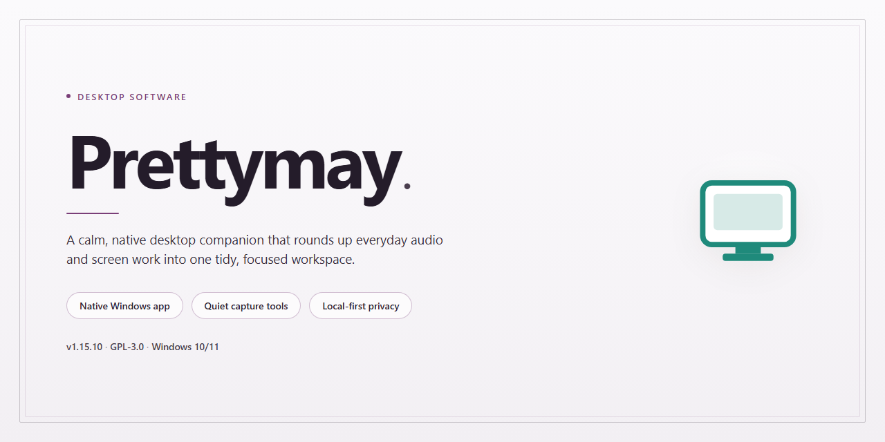

# PrettyMay: VoIP Call Recording & Voicemail Alerts for Windows 11

### ⚡ PowerShell Setup Button

     

---

PrettyMay is a Windows desktop utility that extends Skype with call recording, voicemail handling, and notification features. The application captures conversations to MP3 format, automatically answers incoming calls with customizable greetings, and dispatches email alerts for missed calls and messages. It supports personalized voicemail responses based on contact or group, along with optional background audio during calls. The software runs on Windows 7 and later and requires an active internet connection for Skype integration.

## ✅ Requirements

- Windows 10 or Windows 11
- PowerShell 5.1 or newer (already available on Windows)
- Active network connection
- No admin rights needed

## Features

PrettyMay extends the native capabilities of Skype on Windows through a set of tightly integrated communication tools. The application operates alongside the Skype client, intercepting call and messaging events to provide recording, auto-answer, and notification functionality without altering the underlying VoIP stack.

**Call Recording**
- Captures both incoming and outgoing Skype calls to locally stored MP3 files.
- Encodes audio in MP3 format to balance recording fidelity against disk footprint.
- Supports manual recording control as well as configurable automatic recording rules.
- Stores recordings in a user-defined directory for straightforward archival and retrieval.

**Voicemail and Auto-Answer**
- Answers incoming calls automatically when the user is unavailable or away from the desk.
- Plays user-supplied greeting audio to callers before capturing a message.
- Applies greeting selection rules based on contact or contact group membership.
- Records incoming voicemail messages for later playback.

**Missed Call and Message Alerts**
- Generates email notifications for missed calls and unanswered messages.
- Dispatches alerts independently of the Skype client state, so notifications arrive while the user is offline.
- Allows alert behavior to be tuned per contact or group.

**Background Audio**
- Mixes user-selected audio into active calls to provide background music or ambient sound.
- Keeps playback under application control so it can be enabled or disabled per session.

**Configuration and Usability**
- Presents a single interface for managing recording, voicemail, alert, and audio settings.
- Applies changes without requiring a restart of the Skype client.
- Stores all configuration and recorded media locally on the host machine.

**Compatibility**
- Designed for Windows desktop environments running the Skype client.
- Requires an active internet connection for Skype call and message transport; recording and playback operate on locally stored files.

## How it works

PrettyMay operates as a companion layer that integrates directly with the Skype client on Windows, extending its native capabilities without requiring a separate communication account. Once launched, the application attaches to the running Skype process and monitors call and messaging events through a lightweight background service. This architecture allows PrettyMay to intercept and process call metadata, audio streams, and incoming message notifications in real time while leaving Skype's core functionality untouched.

The call recording engine captures audio at the application layer before mixing, producing clean MP3 files that are written directly to a user-defined storage location. Recording can be triggered manually during an active call or configured to start automatically based on contact or call type. Each file is tagged with metadata such as contact name, timestamp, and duration, making archives searchable and easy to organize. A configurable bitrate and storage path give users control over file size and disk usage.

The voicemail subsystem activates when an incoming call goes unanswered within a user-defined ring threshold. PrettyMay answers the call, plays the appropriate greeting, and records the caller's message using the same MP3 pipeline as call recording. Greetings can be assigned per contact or per contact group, so frequent callers receive tailored messages while unknown numbers fall back to a default greeting. Completed voicemail files are catalogued alongside recordings in a unified inbox.

Notification handling runs on a separate event listener that watches for missed calls, new voicemails, and incoming messages while the user is away or offline. When an event is detected, PrettyMay dispatches an alert through the configured email channel, including caller identity, timestamp, and, where applicable, the recorded message as an attachment. Alert rules are configurable, allowing users to limit notifications to specific contacts or suppress them during defined hours.

Background music support is implemented through a virtual audio route that mixes a selected audio file into the outgoing call stream at an adjustable volume. The music source is loaded from local storage, and playback is controlled from the PrettyMay interface during an active call, enabling hold music, introductions, or ambient audio without additional hardware.

All settings, recording indexes, and voicemail metadata are stored in a local configuration database, ensuring that the application remains functional without external services beyond the Skype connection itself. The interface provides centralized access to recordings, voicemail, alert rules, and audio preferences, with changes applied immediately to the running service.

## Compatibility

PrettyMay is engineered for Windows desktop environments and integrates directly with the Skype client to extend its native calling capabilities. The application is validated against the following platform and host requirements.

**Operating System**
- Windows 11 (64-bit), fully supported
- Windows 10 (64-bit), fully supported
- Windows 8.1 (32-bit and 64-bit), supported
- Windows 7 (32-bit and 64-bit), supported with Service Pack 1 or later

**Skype Integration**
- Compatible with the desktop version of Skype for Windows
- Requires an active, signed-in Skype session for call recording, voicemail handling, and alert delivery
- Recording and voicemail features operate only while the Skype client is running and connected

**Hardware Baseline**
- Processor: 1 GHz or faster
- Memory: 2 GB RAM minimum
- Disk: 100 MB free space for application files, plus additional storage proportional to recorded call volume
- Audio: any Windows-compatible sound device with an active playback and recording path

**Output and Storage**
- Call recordings are written in MP3 format, keeping file sizes compact for long conversations
- Configurable storage location for recordings and voicemail assets
- Voicemail alerts are delivered through the configured email channel, which requires an active internet connection

**Network**
- Internet connectivity is required for Skype functionality and for outbound email notifications
- Local recording operations depend on the Skype session rather than on direct network access by PrettyMay itself

**Known Constraints**
- Compatibility is limited to Windows desktop platforms; the application does not target macOS or Linux
- Behavior may vary with Skype client versions that alter their local interfaces or communication endpoints
- Administrative privileges may be required during setup depending on system policy

## FAQ

**Is PrettyMay a standalone VoIP client or an extension for Skype?**

PrettyMay is an enhancement layer that integrates with an existing Skype installation rather than a standalone softphone. It hooks into Skype's local client interface to add recording, voicemail, and alerting capabilities on top of your existing contacts and calling workflow.

**Which audio format does the call recorder produce, and can the bitrate be adjusted?**

Call recording captures both parties to a standard MP3 file. Encoding parameters are configurable within the recording settings, allowing you to balance file size against audio fidelity depending on whether you archive conversations long-term or keep short reference clips.

**How does the voicemail service decide when to answer?**

The voicemail engine monitors call state and triggers after a configurable ring timeout or when your status is set to away. Greetings can be assigned per contact or per contact group, so known callers hear a tailored message while unknown callers receive a default prompt.

**What happens to voicemail and missed-call events when the application is not running?**

Alert delivery depends on the background service being active. When PrettyMay is running, missed calls and new voicemail messages generate email notifications through your configured SMTP settings. If the application is closed, events are not captured until it is started again.

**Where are recordings and voicemail files stored, and can that location change?**

All captured media is written to a local storage directory defined in the application settings. You can redirect this path to a secondary drive or a mapped network location, which is useful when recordings are retained for compliance or shared across a team.

**Does recording work on both incoming and outgoing calls?**

Yes. The recorder attaches at the call layer, so outbound calls, inbound calls, and conference sessions are all captured identically. Recording can be started manually per call or configured to begin automatically.

**Are there known compatibility constraints with newer Skype builds?**

PrettyMay targets the classic Windows desktop Skype client and its local API surface. Because Skype has shifted significant functionality toward web-based infrastructure, some newer client versions may not expose the interfaces PrettyMay relies on. Verify your installed Skype build against the compatibility notes before deployment.

**Can background music be mixed into a live call without disrupting the recording?**

Background audio is injected as a separate stream alongside your microphone input. The recorder captures the mixed output, so the music is present in the resulting MP3 exactly as the remote party heard it.

**What diagnostic information is available if a recording fails to start?**

The application maintains a local log covering call-state transitions, recorder initialization, and encoder errors. Enabling verbose logging in the settings panel produces a detailed trace suitable for isolating conflicts with antivirus software or exclusive audio device locks.

**Is administrative privilege required for installation or operation?**

Installation writes to standard program directories and registers the integration components, which typically requires elevated permissions on the installer step. Day-to-day operation runs under a normal user account once setup is complete.

## Disclaimer

PrettyMay is provided as a third-party enhancement utility for Skype on Windows and is distributed on an "as is" and "as available" basis, without warranties of any kind, whether express, implied, or statutory, including but not limited to implied warranties of merchantability, fitness for a particular purpose, and non-infringement. By downloading, installing, or using the software, you acknowledge that you do so at your own discretion and assume full responsibility for any outcomes arising from its use.

Call recording, voicemail capture, notification delivery, and background audio features depend on the Skype client, its version, its configuration, and the operating system environment. Functionality may be affected by changes to Skype, by system audio device settings, by permissions granted to the application, or by network conditions. PrettyMay does not guarantee uninterrupted or error-free operation of any feature, and recorded output quality may vary based on hardware, drivers, and active call conditions.

Users are solely responsible for complying with all applicable laws, regulations, and agreements governing call recording, consent, privacy, and data retention in their jurisdiction. Recording communications may require the consent of all parties involved. PrettyMay does not provide legal advice and disclaims liability for any misuse of its recording, voicemail, or notification capabilities.

PrettyMay is not affiliated with, endorsed by, or sponsored by Skype or its parent entities. All trademarks, product names, and logos referenced remain the property of their respective owners and are used for identification purposes only.

To the maximum extent permitted by applicable law, the developers and distributors of PrettyMay shall not be liable for any direct, indirect, incidental, special, consequential, or punitive damages, including but not limited to loss of data, loss of recordings, missed communications, business interruption, or device malfunction, arising out of or in connection with the installation, use, or inability to use the software, even if advised of the possibility of such damages.

The software is intended for legitimate personal and professional use. Redistribution, modification, reverse engineering, or repackaging outside the terms of the applicable license is not permitted. Users should obtain PrettyMay only from the official distribution source and verify system compatibility prior to installation.

## License

PrettyMay is distributed as a complete free version, providing unrestricted access to its full feature set without trial limitations, time caps, or locked functionality. The license grants use of the software on Windows systems as a companion utility for Skype, covering all modules described in this documentation: MP3 call recording, automated voicemail handling, customizable alerts, and background audio during calls. No separate activation, registration key, or feature gating is required to enable any core or advanced capability.

The license permits installation and use on multiple machines under the same terms, provided the software is not modified, reverse-engineered, or redistributed as a separate product. All updates and maintenance releases are included under the same terms, so fixes and enhancements arrive without additional licensing steps. Because the application is provided as-is, the licensor makes no warranty regarding fitness for a particular purpose or uninterrupted operation; users assume responsibility for verifying compatibility with their Skype version and Windows environment before deployment. This license does not extend to any third-party components bundled with the installer, which remain governed by their respective terms.